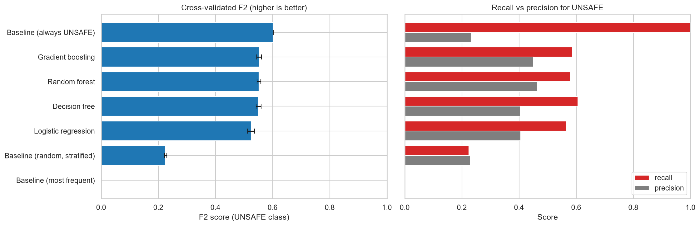
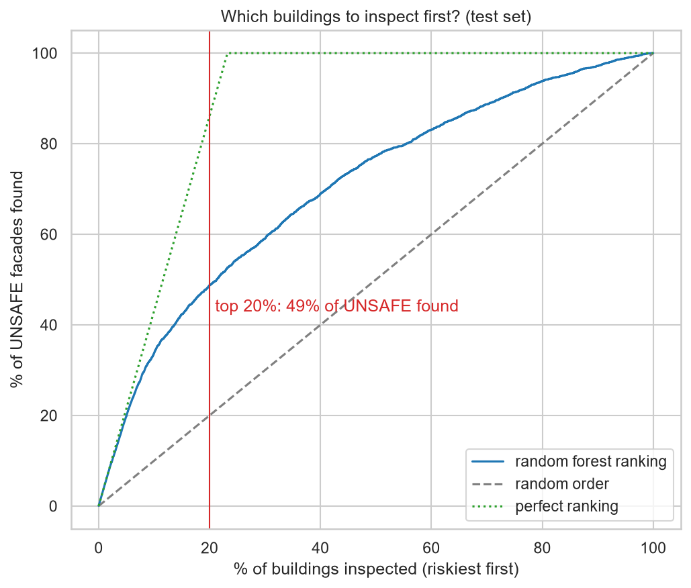
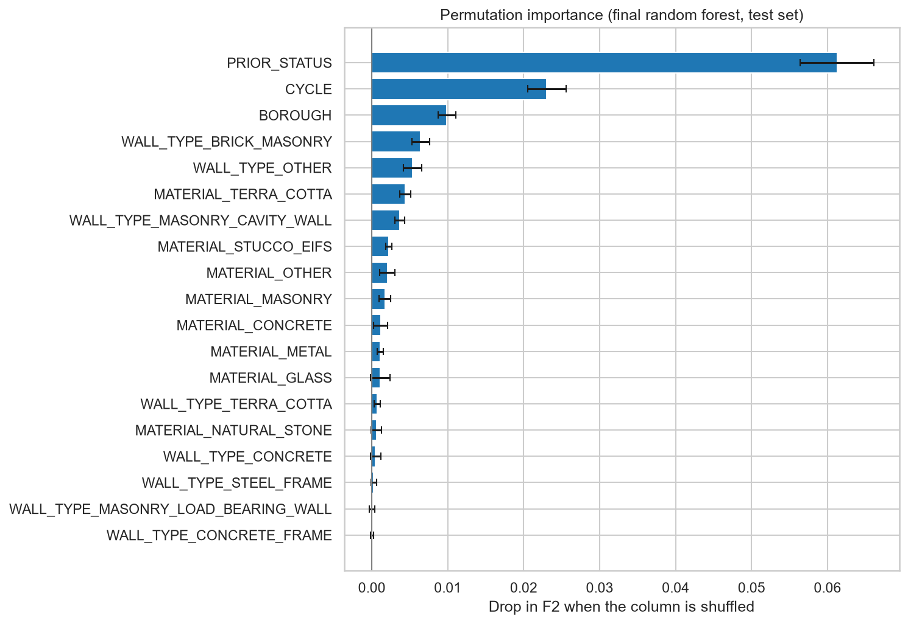

# NYC building facades: predicting unsafe facade inspections

**Team:** Amelia, Jerome, Kazuko, Sahil
**Course:** AI Methods I – Day 2: Supervised learning (IAAC MaAI 2026/27)
**Model on Hugging Face:** https://huggingface.co/iaac-maai/day2-team1-unsafe-facade

## Use case

In New York City, every building taller than 6 stories must have its facade inspected every 5 years (FISP, Local Law 11), and an
**UNSAFE** facade can drop bricks, stone or terra cotta onto the sidewalk. Our model is for the NYC Department of Buildings (DOB) or a
facade consultant, at the **start of a new cycle and before any inspection**, to **rank buildings by risk** and decide which facades to
inspect first. **Missing an UNSAFE facade is the expensive mistake** (someone can be hurt); a false alarm only costs an earlier inspection.
So we favour recall over precision, and the model may only use what is known before the inspection.

## Dataset

| | |
|---|---|
| **Name** | DOB NOW: Safety – Facades Compliance Filings |
| **Source** | [NYC Open Data, data.cityofnewyork.us/d/xubg-57si](https://data.cityofnewyork.us/d/xubg-57si) |
| **One row is** | one facade inspection report for one building in one 5-year cycle |
| **Rows used** | 87,483 raw filings → 67,659 real reports after cleaning → **54,049 initial filings** (15,767 buildings) for the model |
| **Coverage** | New York City, buildings taller than 6 stories, cycles 6 to 10 (about 2001–2026), downloaded 2026-10-23 |
| **Licence** | NYC Open Data, free public use ([terms of use](https://www.nyc.gov/home/terms-of-use.page)) |

The data is not committed: the cleaning notebook downloads it from NYC Open Data.

## Repository structure

```
├── data/                  # raw and cleaned data, downloaded by the notebook (not committed)
├── figures/               # all exported plots (01-09: cleaning and EDA, 10-15: model)
├── models/
│   ├── README.md          # the Hugging Face model card
│   └── model.joblib       # the trained pipeline (not committed: on Hugging Face)
├── notebook/
│   ├── data_cleaning_and_EDA.ipynb   # 1. download, clean and explore the data
│   └── supervised_learning.ipynb     # 2. train, evaluate and save the model
├── .gitignore
├── LICENSE
├── README.md
└── requirements.txt       # pinned package versions
```

## How to run

```bash
python -m venv .venv
source .venv/bin/activate        # Windows: .venv\Scripts\activate
pip install -r requirements.txt
```

Then select the `.venv` kernel and run all cells of the two notebooks, **in this order**:

1. `notebook/data_cleaning_and_EDA.ipynb` downloads the dataset and saves the cleaned table to `data/processed/facades_clean.csv`.
2. `notebook/supervised_learning.ipynb` loads that table, trains and evaluates the model, and saves it to `models/model.joblib`.

To only use the trained model, download it from Hugging Face (see the model card for a code example).

## Approach

- **Target:** `IS_UNSAFE` (1 = UNSAFE, 0 = SAFE or SWARMP), **binary classification**. Main metric: **F2**, which counts recall twice as
  much as precision, because a missed UNSAFE facade is worse than an extra inspection. Accuracy is misleading here: only 23% of
  filings are UNSAFE, so always saying "not unsafe" is already 77% accurate.
- **Features (19):** the previous cycle's result (`PRIOR_STATUS`), `BOROUGH`, `CYCLE`, and 1/0 columns for 8 facade materials and
  8 wall types.
- **Removed (leakage and identifiers):** amended and subsequent filings (they only exist after repairs or after an UNSAFE result:
  0% and 61% UNSAFE), so only **initial** filings are used; penalties (given after the result); filing and inspection dates (only known
  after the inspection); building IDs and addresses.
- **Split:** 80/20 with `StratifiedGroupKFold`: stratified on the target **and grouped by building**, so no building is in both the
  training and the test set. 5-fold cross-validation on the training set, with the same folds for every model.
- **Preprocessing** (in a `Pipeline` + `ColumnTransformer`): most-frequent imputation; one-hot encoding for `PRIOR_STATUS`, `BOROUGH`
  and `CYCLE` (none has a natural order; `CYCLE` is a category stored as a number). No scaling: every input is 0/1.
- **Models compared:** 3 baselines, logistic regression (linear), decision tree, random forest and gradient boosting (tree ensembles),
  all with `class_weight="balanced"`. Then a validation curve on `max_depth`, a `GridSearchCV`, and a decision threshold tuned for F2
  with cross-validation.

## Results

5-fold cross-validation on the training set (43,239 filings), default threshold 0.50:

| Model | F2 (mean ± std) | Recall | Precision | Balanced accuracy |
|---|---|---|---|---|
| Baseline (always "not UNSAFE") | 0.000 ± 0.000 | 0.000 | 0.000 | 0.500 |
| Baseline (random, stratified) | 0.225 ± 0.013 | 0.224 | 0.229 | 0.498 |
| Baseline (always UNSAFE: "inspect everything") | 0.602 ± 0.000 | 1.000 | 0.232 | 0.500 |
| Logistic regression | 0.525 ± 0.012 | 0.566 | 0.406 | 0.658 |
| Decision tree (depth 6) | 0.551 ± 0.009 | 0.605 | 0.405 | 0.668 |
| **Random forest** | **0.554 ± 0.005** | 0.582 | **0.464** | **0.689** |
| Gradient boosting | 0.554 ± 0.008 | 0.586 | 0.454 | 0.687 |

The three tree models tie (differences below one standard deviation); logistic regression is clearly lower.



**Final model:** random forest (200 trees, `max_depth=12`, `max_features=0.5`, `class_weight="balanced"`) with a decision threshold of
**0.30** tuned for F2. Hyperparameter tuning gained only 0.002 F2 (noise); lowering the threshold from 0.50 to 0.30 raised CV F2 from
0.556 to 0.627.

**Test set** (10,810 filings from 3,181 unseen buildings, used once):

| Metric | Test | Cross-validation |
|---|---|---|
| F2 | **0.631** | 0.627 ± 0.002 |
| Recall (UNSAFE) | **0.920** | 0.909 ± 0.005 |
| Precision (UNSAFE) | 0.280 | 0.279 ± 0.002 |
| Balanced accuracy | 0.602 | 0.600 ± 0.004 |
| Average precision (ranking) | **0.605** (random: 0.232) | – |

The test scores match cross-validation. As a yes/no classifier the model catches 92% of UNSAFE facades but flags 76% of all buildings,
so its F2 is only slightly above "inspect everything" (0.602). **Its real value is the ranking:** inspecting the riskiest 10% of buildings
first finds **34%** of all UNSAFE facades (3.4× better than random), the riskiest 20% finds **49%**.



The model relies mostly on the **previous inspection result** (a previously UNSAFE facade has ~5× the odds of being UNSAFE again), then on
the cycle and the borough; materials and wall types add little.



## Limitations

- **The model mostly repeats history.** It is weakest for previously SAFE facades that deteriorate (recall 0.79, precision 0.20), which is
  exactly what inspections must catch. It must never replace an inspection, only help to order them.
- **Missing information:** no building age, height, size, renovation history or weather exposure, which probably matter more.
- **The label is a human judgement:** inspectors can rate the same facade differently, and the rules changed between cycles.
- **Correlation, not causation:** borough and cycle stand in for things we don't have (building stock, budgets, inspection practice).
- **Coverage:** NYC only, buildings over 6 stories, only filed reports. Not valid for other cities or for future cycles with new rules.
- **Metric choice:** with a weak signal, F2 rewards flagging almost everything. In hindsight, average precision or recall in the top 20%
  would match the ranking use case better.

## AI usage disclosure

| | |
|---|---|
| **Tools** | Claude Code (agent, in VS Code), *(team: add any other tools you used, e.g. ChatGPT)* |
| **Why** | To help beginners with Git/GitHub, to structure the repository and notebooks according to the brief, and to explain machine learning concepts |
| **Where** | Git and GitHub setup (forks, pull requests, syncing), repository structure, `.gitignore` and `requirements.txt`, the supervised learning notebook, re-running the notebooks, the model card and this README |
| **How** | The agent edited files and ran commands itself (git, running notebooks, checking results), with each action approved by us. Example prompts: *"please create a folder named data and another one called figures"*, *"give me a summary of the data cleaning"*, *"what is F2 score"*, *"lets save the model and upload it to huggingface"*. We checked the output by reading the notebook step by step, asking the agent to explain every concept we did not understand (F2, leakage, cross-validation, thresholds), and comparing the numbers in the text with the notebook outputs. *(team: add what you corrected or rejected)* |

**Lessons learned:** asking the agent to *explain* (not only to do) was the most useful part: it made the notebook understandable for
beginners. Checking the agent's work mattered: re-running the notebook on another computer gave slightly different results, which we had
to notice and update everywhere. Git was the hardest part at the start (working in a fork without access to the team repository).
*(team: add your own lessons)*

## License

Code released under the [MIT License](LICENSE). The dataset is subject to its own licence (NYC Open Data terms of use, see above).
