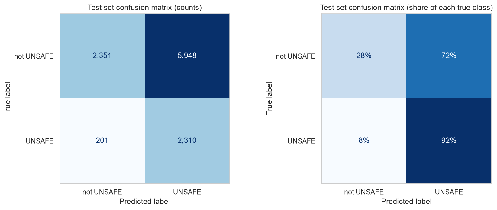
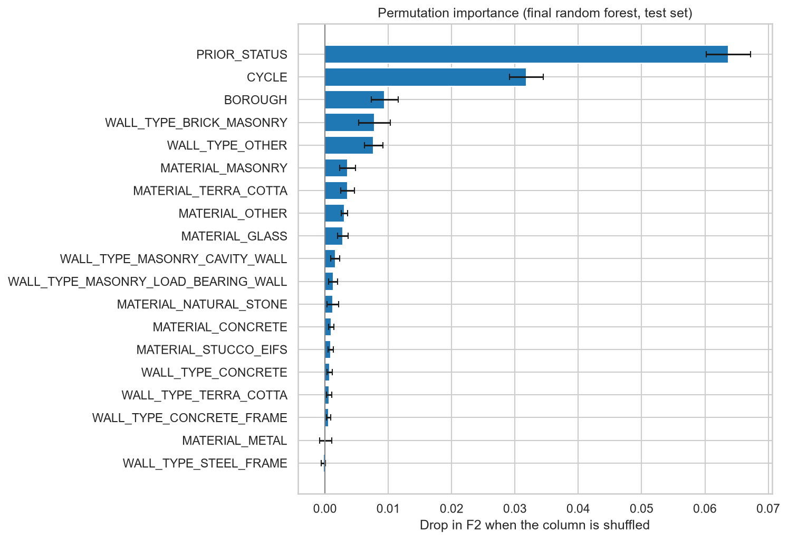

# Unsafe facade predictor: ranking NYC buildings by facade inspection risk

This model predicts whether a New York City building's next facade inspection (FISP, Local Law 11) will come out **UNSAFE**,
using only what is known *before* the inspection: the result of the previous 5-year cycle, the borough, the cycle, and the
facade materials and wall types. It is meant to help the NYC Department of Buildings or a facade consultant decide **which
buildings to inspect first**. It is a scikit-learn pipeline (one-hot encoding + random forest + a decision threshold tuned for F2)
trained on 43,239 initial facade filings from NYC Open Data. It was built as a course assignment for AI Methods I (IAAC MaAI 2026/27).

- **GitHub repository (full pipeline):** https://github.com/iaac-maai/group1_day2_assignment
- **Team:** Amelia, Jerome, Kazuko, Sahil

## Intended use

- **Intended users and use:** the NYC Department of Buildings (DOB) or a facade consultant, at the start of a new 5-year cycle and
  before any inspection, to **rank buildings by risk** and decide which facades to inspect and follow up first.
  Use the **probability** to order buildings; the yes/no output alone flags most buildings (see Evaluation).
- **Out-of-scope uses:**
  - replacing an inspection, or as evidence that a specific facade is safe
  - other cities, or buildings of 6 stories or less (not covered by FISP, not in the data)
  - future cycles with new rules: a cycle not seen in training (e.g. 11) is encoded as all zeros
  - amended or subsequent filings (the model was trained on initial filings only)

## Model details

| | |
|---|---|
| **Problem type** | Binary classification |
| **Target** | `IS_UNSAFE`: 1 = UNSAFE, 0 = SAFE or SWARMP |
| **Algorithm** | `RandomForestClassifier` (bagged decision trees) wrapped in `TunedThresholdClassifierCV` (decision threshold tuned with cross-validation) |
| **Key hyperparameters** | `n_estimators=200`, `max_depth=12`, `max_features=0.5`, `min_samples_leaf=1`, `class_weight="balanced"`, `random_state=42`; decision threshold **0.30** (0.295) |
| **Preprocessing** | Nominal columns: most-frequent imputation + one-hot encoding (`handle_unknown="ignore"`). `CYCLE` is a category stored as a number, so it is one-hot encoded, not treated as a quantity. 1/0 material and wall columns: most-frequent imputation. No scaling (all inputs are 0/1 after encoding). 19 input columns become 31 features. |
| **File** | `model.joblib`: the whole fitted object (preprocessing + random forest + threshold), saved with `joblib` |
| **Library versions** | scikit-learn 1.9.1, pandas 3.1.0, numpy 2.5.4, joblib 1.6.0, Python 3.14 |
| **Authors** | Amelia, Jerome, Kazuko, Sahil |

## Input features

The model expects a `pandas.DataFrame` with **exactly these 19 columns**. Missing values (`NaN`) are allowed; they are imputed with the most frequent training value. Unknown categories are allowed; they are ignored by the one-hot encoder.

| Column | Type | Unit | Description | Preprocessing |
|---|---|---|---|---|
| `PRIOR_STATUS` | category (text) | – | result of the building's previous cycle: `SAFE`, `SWARMP`, `UNSAFE`, `NO REPORT FILED`, or `NO PRIOR CYCLE` (first cycle in the data) | one-hot |
| `BOROUGH` | category (text) | – | `MANHATTAN`, `BROOKLYN`, `BRONX`, `QUEENS`, `STATEN ISLAND` | one-hot |
| `CYCLE` | category (**text**, not a number) | – | FISP cycle: `"6"` to `"10"` | one-hot |
| `MATERIAL_MASONRY` | 1.0 / 0.0 | – | facade has masonry | most-frequent imputation |
| `MATERIAL_OTHER` | 1.0 / 0.0 | – | facade has a material listed as "other" | most-frequent imputation |
| `MATERIAL_TERRA_COTTA` | 1.0 / 0.0 | – | facade has terra cotta | most-frequent imputation |
| `MATERIAL_NATURAL_STONE` | 1.0 / 0.0 | – | facade has natural stone | most-frequent imputation |
| `MATERIAL_CONCRETE` | 1.0 / 0.0 | – | facade has concrete | most-frequent imputation |
| `MATERIAL_STUCCO_EIFS` | 1.0 / 0.0 | – | facade has stucco / EIFS | most-frequent imputation |
| `MATERIAL_GLASS` | 1.0 / 0.0 | – | facade has glass | most-frequent imputation |
| `MATERIAL_METAL` | 1.0 / 0.0 | – | facade has metal | most-frequent imputation |
| `WALL_TYPE_BRICK_MASONRY` | 1.0 / 0.0 | – | brick masonry wall | most-frequent imputation |
| `WALL_TYPE_OTHER` | 1.0 / 0.0 | – | wall type listed as "other" | most-frequent imputation |
| `WALL_TYPE_MASONRY_LOAD_BEARING_WALL` | 1.0 / 0.0 | – | load-bearing masonry wall | most-frequent imputation |
| `WALL_TYPE_TERRA_COTTA` | 1.0 / 0.0 | – | terra cotta wall | most-frequent imputation |
| `WALL_TYPE_MASONRY_CAVITY_WALL` | 1.0 / 0.0 | – | masonry cavity wall | most-frequent imputation |
| `WALL_TYPE_STEEL_FRAME` | 1.0 / 0.0 | – | steel frame | most-frequent imputation |
| `WALL_TYPE_CONCRETE` | 1.0 / 0.0 | – | concrete wall | most-frequent imputation |
| `WALL_TYPE_CONCRETE_FRAME` | 1.0 / 0.0 | – | concrete frame | most-frequent imputation |

A facade can have several materials and wall types (several columns = 1).

## Output

- `model.predict(X)` returns **1 (UNSAFE)** or **0 (not UNSAFE: SAFE or SWARMP)**, using the tuned threshold of 0.30.
- `model.estimator_.predict_proba(X)[:, 1]` returns the **probability of UNSAFE** (0 to 1). This is the recommended output:
  sort buildings by it to decide the order of inspections.

SWARMP = "Safe With A Repair and Maintenance Program": not dangerous yet, but repairs are needed before the next cycle.

## Training data

| | |
|---|---|
| **Dataset** | DOB NOW: Safety – Facades Compliance Filings |
| **Source** | [NYC Open Data, data.cityofnewyork.us/d/xubg-57si](https://data.cityofnewyork.us/d/xubg-57si) |
| **Licence** | NYC Open Data, free public use ([terms of use](https://www.nyc.gov/home/terms-of-use.page)) |
| **Origin** | NYC Department of Buildings, Facade Inspection & Safety Program (FISP, Local Law 11): every building taller than 6 stories must have its facade inspected every 5 years by a licensed inspector (QEWI) |
| **One row is** | one facade inspection report for one building in one 5-year cycle |
| **Size used** | 54,049 initial filings from 15,767 buildings (train 43,239; test 10,810) |
| **Coverage** | New York City, buildings taller than 6 stories, cycles 6 to 10 (about 2001–2026), downloaded 2026-10-23 |

**Cleaning:** from 87,483 raw filings, duplicates and 19,799 auto-generated "no report filed" placeholders were removed, text was
standardised, dates and typos fixed, and the material and wall-type lists turned into 1/0 columns (67,659 real reports;
see `notebook/data_cleaning_and_EDA.ipynb`).

**Leakage:** only **INITIAL** filings are used. Amended filings (corrections after repairs, 0% UNSAFE) and subsequent filings
(follow-ups that only exist because a facade was UNSAFE, 61% UNSAFE) give the answer away. Penalties (given after the result),
filing and inspection dates (only known once the inspection is done) and the building's current status were also removed
from the inputs. Identifiers and addresses (`BIN`, block, lot, street) were removed so the model learns patterns, not buildings.

## Training procedure

- **Split:** 80 / 20 train/test with `StratifiedGroupKFold` (`random_state=42`): stratified on the target **and grouped by
  building (BIN)**, so no building is in both sets (the same building appears in up to 5 cycles).
- **Validation:** 5-fold `StratifiedGroupKFold` cross-validation on the training set, the same folds for every model.
- **Main metric:** F2 (recall counts twice as much as precision: missing an UNSAFE facade is worse than an extra inspection).
- **Models compared** (5-fold CV, default threshold 0.50):

| Model | CV F2 (mean ± std) | CV recall | CV precision |
|---|---|---|---|
| Baseline (most frequent: always "not UNSAFE") | 0.000 ± 0.000 | 0.000 | 0.000 |
| Baseline (random, stratified) | 0.225 ± 0.013 | 0.224 | 0.229 |
| Baseline (always UNSAFE: "inspect everything") | 0.602 ± 0.000 | 1.000 | 0.232 |
| Logistic regression | 0.525 ± 0.012 | 0.566 | 0.406 |
| Decision tree (depth 6) | 0.551 ± 0.009 | 0.605 | 0.405 |
| Random forest (200 trees) | 0.554 ± 0.005 | 0.582 | 0.464 |
| Gradient boosting (HistGradientBoosting) | 0.554 ± 0.008 | 0.586 | 0.454 |

All models train in about 2 seconds or less per fold. The three tree models are within 0.003 of each other (less than one standard
deviation): a tie. Logistic regression is about 3 standard deviations lower: a real gap.

- **Tuning:** validation curve on `max_depth` (best 12, mild overfitting above), then `GridSearchCV` on depth, leaf size and
  features per split (best: depth 12, 50% of features, `min_samples_leaf=1`): CV F2 0.556 vs 0.554 (within noise). The decision threshold was then tuned with
  `TunedThresholdClassifierCV` on the same folds: **0.30**, CV F2 **0.627 ± 0.002**.
- **Why this model:** the three tree models tie on F2; the random forest has the best precision and balanced accuracy,
  trains in about a second, and is clearly better than logistic regression.

## Evaluation

Results on the held-out **test set** (10,810 filings from 3,181 unseen buildings, used once), threshold 0.30:

| Metric | Test | Cross-validation |
|---|---|---|
| F2 | 0.631 | 0.627 ± 0.002 |
| Recall (UNSAFE) | 0.920 | 0.909 ± 0.005 |
| Precision (UNSAFE) | 0.280 | 0.279 ± 0.002 |
| Balanced accuracy | 0.602 | 0.600 ± 0.004 |
| Accuracy | 0.431 | 0.434 ± 0.007 |
| Baseline "always UNSAFE" F2 | 0.602 | 0.602 |

As a **ranking** (probability of UNSAFE): average precision **0.605** (random order: 0.232), ROC AUC **0.766**.
Inspecting the riskiest **10%** of buildings first finds **34%** of all UNSAFE facades (3.4× better than random);
the riskiest **20%** finds **49%**.




**Where it performs worst:**
- As a yes/no classifier it flags **76%** of buildings: it catches 92% of UNSAFE facades but only 28% of its alarms are right,
  and its F2 is only slightly above "inspect everything".
- **Previously SAFE facades** that become UNSAFE: recall 0.79 and precision 0.20, the main signal points the wrong way.
- **Previous cycle without a report:** lowest recall (0.60), on only 421 test filings.
- **Previously SWARMP** and **cycles 8–9**: almost all flagged, many false alarms.

**What the model relies on** (permutation importance on the test set): mostly the **previous inspection result**
(F2 drops 0.064 when it is shuffled, 2× more than any other input), then **cycle** (0.032) and **borough** (0.009).
Materials and wall types add very little (≤ 0.008 each); their directions agree with engineering sense: terra cotta is more
often UNSAFE (it cracks and its steel anchors rust), glass curtain walls and brick masonry walls less often.



## Limitations and biases

- **The model mostly repeats history:** the previous result is by far the most important input (a previously UNSAFE facade
  has ~5× the odds of being UNSAFE again). It is weakest exactly for good facades that deteriorate, which inspections must catch.
  **It must never replace an inspection, only help to order them.**
- **Missing information:** no building age, height, size, renovation history or weather exposure, which probably matter more.
- **The label is a human judgement:** two inspectors can rate the same facade differently, and rules changed between cycles.
- **Correlation, not causation:** borough and cycle are proxies (building stock, maintenance budgets, rules, inspection practice).
- **Selection bias:** only inspections that were actually filed; buildings whose owners never filed are not represented.
- **Unseen categories:** a new cycle or borough value is encoded as all zeros, so predictions for future cycles are less reliable.

## How to use

Requirements: `pip install scikit-learn==1.9.1 pandas joblib huggingface_hub`

```python
import joblib
import pandas as pd
from huggingface_hub import hf_hub_download

path = hf_hub_download(repo_id="iaac-maai/day2-group1-unsafe-facade", filename="model.joblib")
model = joblib.load(path)

materials = ["MASONRY", "OTHER", "TERRA_COTTA", "NATURAL_STONE", "CONCRETE", "STUCCO_EIFS", "GLASS", "METAL"]
wall_types = ["BRICK_MASONRY", "OTHER", "MASONRY_LOAD_BEARING_WALL", "TERRA_COTTA",
              "MASONRY_CAVITY_WALL", "STEEL_FRAME", "CONCRETE", "CONCRETE_FRAME"]

# A Brooklyn building at the start of cycle 10, UNSAFE last cycle, masonry + terra cotta, load-bearing walls
row = {"PRIOR_STATUS": "UNSAFE", "BOROUGH": "BROOKLYN", "CYCLE": "10"}
row.update({f"MATERIAL_{m}": float(m in ["MASONRY", "TERRA_COTTA"]) for m in materials})
row.update({f"WALL_TYPE_{w}": float(w == "MASONRY_LOAD_BEARING_WALL") for w in wall_types})
example = pd.DataFrame([row])

print("Probability of UNSAFE:", model.estimator_.predict_proba(example)[0, 1].round(2))
print("Prediction (1 = UNSAFE):", model.predict(example)[0])
```

⚠️ **Security:** `.joblib` files are Python pickles and can execute code when loaded. Only load models from sources you trust.
Use **scikit-learn 1.9.1**: the model may not load, or may behave differently, with other versions.

## Reproducibility

The full pipeline is in the GitHub repository https://github.com/iaac-maai/group1_day2_assignment:

1. `notebook/data_cleaning_and_EDA.ipynb` downloads the raw data from NYC Open Data and produces `data/processed/facades_clean.csv`.
2. `notebook/supervised_learning.ipynb` trains, compares, tunes, evaluates and saves this model (section 7).

The packages and exact versions are in the repository's `requirements.txt`. All random steps use `random_state=42`.

## Authors and licence

Amelia, Jerome, Kazuko, Sahil. Course assignment for **AI Methods I: Machine Learning for the Built Environment**, IAAC MaAI 2026/27.

Model released under the MIT License. The training data is NYC Open Data, subject to the
[NYC Open Data terms of use](https://www.nyc.gov/home/terms-of-use.page).
